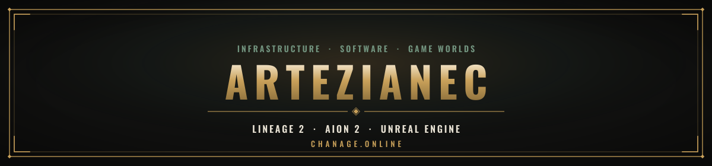
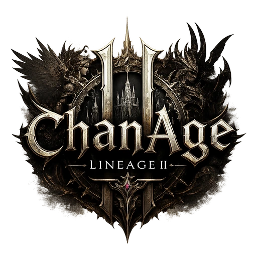
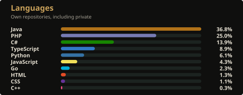

  

  

  
  
  
  

  

## About Me

<table>
  <tr>
    <td width="230" align="center" valign="middle">
      
       
      <b>Artezianec</b>
       
      Dmitry Shetko · Israel · Русский / English
    </td>
    <td valign="top">
      <b>Work.</b> Backend and infrastructure engineer at a cloud hosting and VPS provider: PHP, Go, gRPC/RPC services and Proxmox automation. I also do AI automation, write custom programs and apps, and develop games in Unreal Engine.
        
      <b>Worlds.</b> I run ChanAge — private game servers and the community around them. The front door is <a href="https://chanage.online">chanage.online</a>.
        
      <i>Работаю с облачной и VPS-инфраструктурой, пишу софт и ИИ-автоматизацию, собираю игровые миры ChanAge и игры на Unreal Engine.</i>
        
      <b>Lineage 2.</b> Essence chronicle Samurai Crow: the Samurai class, Crow Village, castle sieges and live PvP.
        
      <b>Aion 2.</b> I maintain <a href="https://github.com/Artezianec/A2Core-ChanAge">A2Core-ChanAge</a>, a community fork of the A2Core emulator written in C# and .NET 10.
        
      <b>Community.</b> On Discord I'm Artez — that's where we follow tests, launches and everyday life on the servers.
    </td>
  </tr>
</table>

---

## What I Do

| Area | Focus |
| --- | --- |
| **Cloud & VPS infrastructure** | PHP, Go, gRPC/RPC services, and Proxmox automation |
| **AI automation** | LLM agents and workflow automation, including work with large Israeli companies |
| **Software development** | Custom programs and applications |
| **Unreal Engine** | Game development in UE and C++ |
| **Private game servers** | ChanAge: Lineage 2 Essence Samurai Crow and the Aion 2 emulator |

---

## What I Work On

| Project | What it is |
| --- | --- |
| **[A2Core-ChanAge](https://github.com/Artezianec/A2Core-ChanAge)**  | Community fork of the A2Core Aion 2 emulator, written in C# / .NET 10 |
| **[ChanAge Online](https://chanage.online)** | Home of the ChanAge game worlds — site, launcher and community |
| **Lineage 2 Essence Samurai Crow** | Private L2 Essence server: Samurai class, Crow Village, auto-hunt, PvP and sieges |

---

## Technical Expertise

**Languages**

  

**Game and app development**

  

**Cloud and VPS**

  
  

**Infrastructure**

  

**Tools**

  

---

## GitHub Statistics

  
  

  

---

## Connect

  
  
  

  

